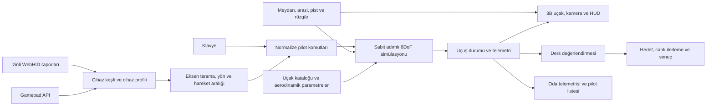

# FlightSimRC motoru ve eğitim mimarisi

## Uygulama sırası

| Aşama | Çalışan sistem için kabul ölçütü |
| --- | --- |
| Kumanda | Gamepad ve izinli HID otomatik keşfedilir. HID tanımlayıcıları kullanılır. Belirsiz kanallar kol hareketiyle eşleşir. Eksenler gelmeden ve gaz düşükken yapılan kurma işlemi tamamlanmadan cihaz uçağı yönetemez. |
| Fizik ve hangar | Katalog kimliği uçuş modelini, görsel temsilini ve oda telemetrisini seçer. Hava hızı, yer hızı, hücum açısı ve yerden yükseklik kendi fizik değerlerinden okunur. |
| Meydan ve görüntü | Pist boyutu ve yükseklik ağı fizik sahasından üretilir. Saha değişince başlangıç konumu, rüzgâr ve görüntü birlikte değişir. |
| Eğitim | Kalkış, sabit irtifa, yaklaşma ve hover hedefleri fizik adımlarından değerlendirilir. Kaza ve başarının nedeni gösterilir. |
| Yayın | Birim testleri, tarayıcı uçuşu ve üretim derlemesi geçer. GitHub Pages sürümünde ikon ve yeni eğitim arayüzü kontrol edilir. |

## Teknik kaynaklar ve doğrulama

- [World Flight Sim](https://worldflightsim.com/) uçuş okulu, hangar, görev ve parkur akışlarını gösteriyor. FlightSimRC için seçim, RC pilot görüşüne uygun kısa ve ölçülebilir alıştırmalardır.
- [Gamepad API](https://developer.mozilla.org/en-US/docs/Web/API/Gamepad_API/Using_the_Gamepad_API), [WebHID](https://developer.chrome.com/docs/capabilities/hid) ve [USB HID kullanım tabloları](https://usb.org/hid) cihaz keşfi ve rapor yorumlamasını tanımlar. İlk doğrudan HID bağlantısı kullanıcı izni gerektirir. İşletim sisteminin ve tarayıcının sunduğu alanlar cihazdan cihaza değişebilir.
- [NASA Glenn kaldırma denklemi](https://www.grc.nasa.gov/www/k-12/WindTunnel/Activities/lift_formula.html) ve [JSBSim hareket denklemleri](https://jsbsim-team.github.io/jsbsim-reference-manual/formulation/equations-of-motion/) kuvvet modeli ve eksen dönüşümleri için referanstır. Parametrik modelleri gerçek RC performansıyla karşılaştırmak için saha ölçümleri gerekir.
- [FAA Airplane Flying Handbook](https://www.faa.gov/regulations_policies/handbooks_manuals/aviation/airplane_handbook) kalkış, enerji yönetimi ve stabilize yaklaşma sıralamasına kaynaklık eder. Eğitim hedefleri RC ölçeğine uyarlanmıştır.

## Fizik doğrulaması

`npm test` regresyonları, `npm run verify:flight` ölçüm satırlarını gösterir.

11 profil için 67 fizik ölçümünden 47'si katalog toleransını sağladı. Kalan 20 ölçüm açık kalibrasyon işidir. Trainer stall senaryosunda en düşük 14,22 m/s gözlendi ve stall bayrağı tetiklenmedi. Kanat alanı, kütle ve varsayımsal kaldırma katsayısından hesaplanan hedef 9,05 m/s. Dolayısıyla bu senaryodan gerçek stall hızı sonucu çıkarılamaz. Üç rotorcraft hover ölçümü hedef aralıkta tamamlandı.

Tarayıcıda klavye girişi, sahne ve model değişimi, ders başlatma, hatalı ve doğru oda şifresi, kurucu devri ve boş oda kapanışı denendi. Fiziksel kumanda testi için işletim sistemi ve tarayıcıya eksen ileten bir cihaz gerekir.
